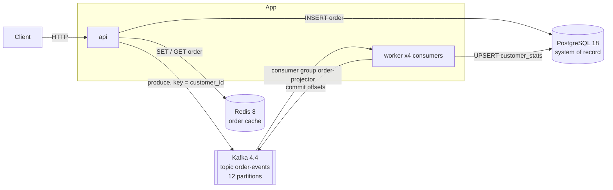
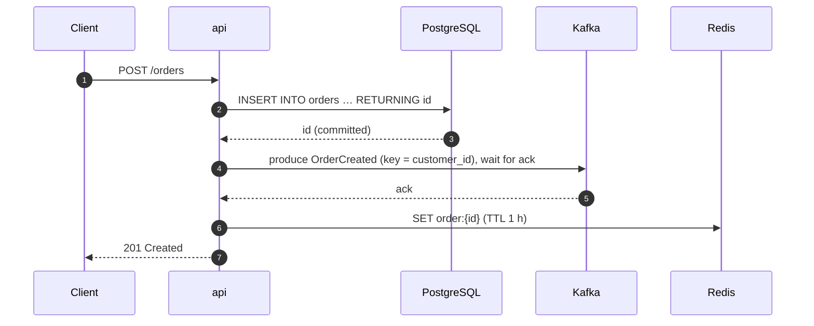
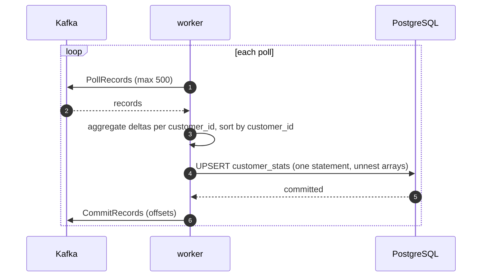
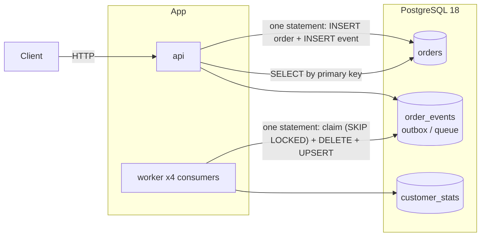
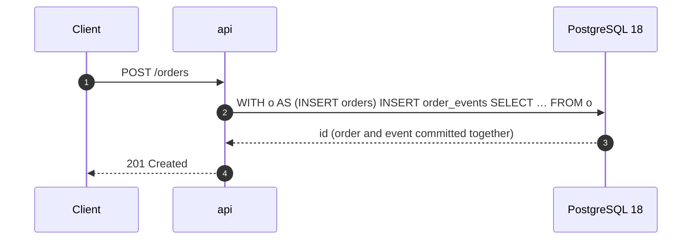
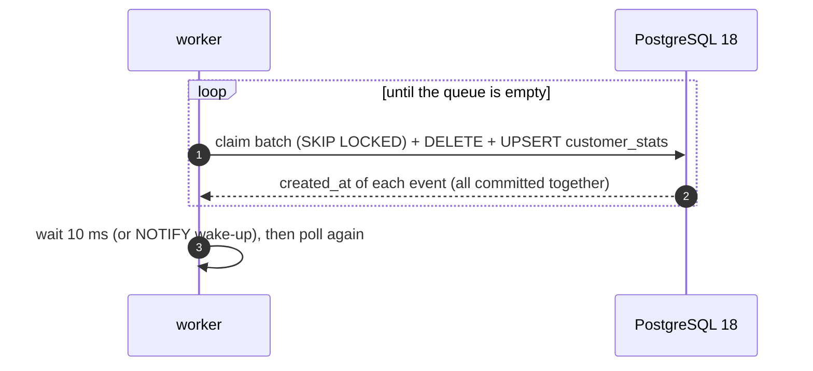
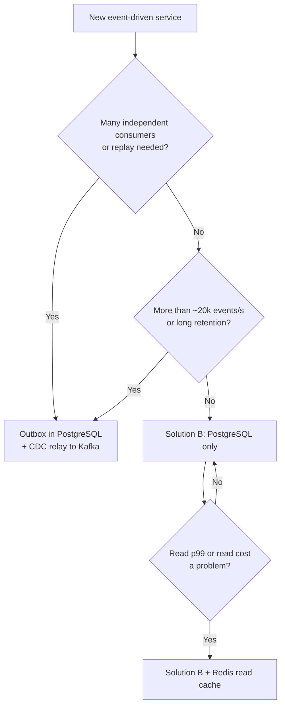

# Architecture solutions: event-driven order service

This document describes two architecture solutions for the same event-driven service:

- **Solution A (classic):** PostgreSQL + Kafka + Redis.
- **Solution B (modern):** PostgreSQL 18 only.

The benchmark results for both solutions are in [RESULT.md](RESULT.md). The run steps are in [README.md](README.md).

## Contents

1. [Business context](#1-business-context)
2. [Solution A: PostgreSQL + Kafka + Redis](#2-solution-a-postgresql--kafka--redis)
3. [Solution B: PostgreSQL 18 only](#3-solution-b-postgresql-18-only)
4. [Comparison](#4-comparison)
5. [Failure analysis](#5-failure-analysis)
6. [Decision guide](#6-decision-guide)
7. [Evolution path](#7-evolution-path)
8. [Operations checklist](#8-operations-checklist)

---

## 1. Business context

### 1.1 Use cases

| ID | Use case | Interface |
|---|---|---|
| UC-1 | Create an order. Emit an `OrderCreated` event. | `POST /orders` |
| UC-2 | Read an order by ID. | `GET /orders/{id}` |
| UC-3 | Keep a read model with the order count and total amount for each customer. | Event consumer |

### 1.2 Components

Both solutions use the same two application components:

| Component | Role |
|---|---|
| `api` | HTTP service. Writes orders and emits events. Serves reads. |
| `worker` | Event consumer. Updates the `customer_stats` read model. |

### 1.3 Requirements

| ID | Requirement |
|---|---|
| R-1 | Each committed order must produce exactly one effect in `customer_stats`. |
| R-2 | The event must reach the read model in milliseconds, not seconds. |
| R-3 | A crash of any process must not lose an event. |
| R-4 | The solution must scale to tens of thousands of writes per second on one node. |
| R-5 | The solution must be simple to operate. |

### 1.4 Data model

Both solutions use the same state tables:

```sql
CREATE TABLE orders (
    id           uuid        PRIMARY KEY DEFAULT uuidv7(),   -- PostgreSQL 18, both solutions
    customer_id  bigint      NOT NULL,
    amount_cents bigint      NOT NULL,
    status       text        NOT NULL,
    created_at   timestamptz NOT NULL
);

CREATE TABLE customer_stats (              -- read model (projection)
    customer_id  bigint      PRIMARY KEY,
    order_count  bigint      NOT NULL,
    total_cents  bigint      NOT NULL,
    updated_at   timestamptz NOT NULL
);
```

Event payload (both solutions):

```json
{ "type": "OrderCreated", "order_id": "…", "customer_id": 42, "amount_cents": 1999, "created_at": "…" }
```

---

## 2. Solution A: PostgreSQL + Kafka + Redis

### 2.1 Component view



### 2.2 Responsibilities

| Component | Responsibility | Configuration in this project |
|---|---|---|
| PostgreSQL 18.7 | System of record (`orders`) and read model (`customer_stats`) | `synchronous_commit=on`, 1 CPU / 2 GB |
| Kafka 4.4.0 (KRaft) | Event log and transport | 1 broker, replication factor 1, 12 partitions, `acks=all`, idempotent producer, 1 CPU / 2 GB |
| Redis 8.10.3 | Read cache for orders | No persistence, `maxmemory 768mb`, `allkeys-lru`, TTL 1 hour, 1 CPU / 1 GB |
| `api` | Dual write: PostgreSQL, then Kafka, then Redis | 1 CPU, pgx pool 96, franz-go producer, go-redis pool 64 |
| `worker` | 4 Kafka consumers in one group, batch up to 500 records | 1 CPU, manual offset commit, `fetch.max.wait` 10 ms |

### 2.3 Write flow (UC-1)



> **WARNING:** Steps 2 and 4 are two separate systems with no common transaction (dual write).
> If the `api` process stops after step 3 and before step 5, the order exists but the event is lost.

### 2.4 Read flow (UC-2)

1. The `api` reads `order:{id}` from Redis.
2. On a cache hit, the `api` returns the value.
3. On a cache miss, the `api` reads the order from PostgreSQL, writes it to Redis, and returns it.

### 2.5 Event consumption flow (UC-3)



- The worker commits offsets **after** the projection commit. This gives **at-least-once** delivery.
- If the worker stops between steps 4 and 5, Kafka delivers the batch again. The projection then counts it twice.
- If the projection fails, the worker retries the same batch with backoff. It does not skip the batch.
- The partition key is `customer_id`. One consumer owns all events of one customer, in order.

### 2.6 Properties

| Property | Value |
|---|---|
| Atomicity of state + event | No (dual write) |
| Delivery guarantee | At-least-once |
| Ordering | Per `customer_id` (per partition) |
| Fan-out to many consumers | Yes: one consumer group per subscriber |
| Replay | Yes: reset the offsets of a consumer group |
| Systems to operate | 3 (PostgreSQL, Kafka, Redis) |

### 2.7 How to close the gaps in Solution A

| Gap | Standard fix | Cost |
|---|---|---|
| Dual write | Transactional outbox in PostgreSQL + relay to Kafka (Debezium CDC or a poller) | One more component; higher event latency |
| Duplicate processing | Store processed event IDs or Kafka offsets in the same transaction as the projection | One more table and one more write per batch |
| Stale cache after an update | Delete or update the Redis key in the same code path as the update, or use CDC | More code paths to keep correct |

---

## 3. Solution B: PostgreSQL 18 only

### 3.1 Component view



### 3.2 Responsibilities

| Component | Responsibility | Configuration in this project |
|---|---|---|
| PostgreSQL 18.7 | System of record, event queue, read model, cache (shared buffers) | `synchronous_commit=on`, `io_method=worker`, 1 CPU / 2 GB or 3 CPU / 5 GB |
| `orders` | State | `uuidv7()` primary key (PostgreSQL 18 native) |
| `order_events` | Transactional outbox and work queue | Identity key, aggressive autovacuum settings |
| `api` | One statement for the order and its event | 1 CPU, pgx pool 96 |
| `worker` | 4 consumers, batch up to 500 events, poll every 10 ms when idle | 1 CPU, optional `LISTEN/NOTIFY` (`PG_NOTIFY=true`) |

### 3.3 Write flow (UC-1)



The statement:

```sql
WITH o AS (
  INSERT INTO orders (customer_id, amount_cents, status, created_at)
  VALUES ($1, $2, 'NEW', $3)
  RETURNING id, customer_id, amount_cents, status, created_at
), e AS (
  INSERT INTO order_events (event_type, payload, created_at)
  SELECT 'OrderCreated',
         jsonb_build_object('order_id', id, 'customer_id', customer_id, 'amount_cents', amount_cents),
         created_at
  FROM o
)
SELECT id::text, status FROM o;
```

- The order and the event commit in **one transaction**. There is no dual-write gap.
- The `api` does **one network round trip** for each order. Solution A does three.

### 3.4 Read flow (UC-2)

1. The `api` reads the order from `orders` by primary key.
2. PostgreSQL serves hot rows from shared buffers. No external cache is necessary.

### 3.5 Event consumption flow (UC-3)



The statement:

```sql
WITH batch AS (
  SELECT id FROM order_events
  ORDER BY id
  LIMIT $1
  FOR UPDATE SKIP LOCKED              -- concurrent workers take different rows
), del AS (
  DELETE FROM order_events e USING batch b
  WHERE e.id = b.id
  RETURNING e.payload, e.created_at
), agg AS (
  SELECT (payload->>'customer_id')::bigint AS customer_id,
         count(*) AS n,
         sum((payload->>'amount_cents')::bigint) AS t
  FROM del GROUP BY 1
), up AS (
  INSERT INTO customer_stats (customer_id, order_count, total_cents, updated_at)
  SELECT customer_id, n, t, now() FROM agg ORDER BY customer_id   -- fixed lock order: no deadlocks
  ON CONFLICT (customer_id) DO UPDATE
  SET order_count = customer_stats.order_count + EXCLUDED.order_count,
      total_cents = customer_stats.total_cents + EXCLUDED.total_cents,
      updated_at  = now()
)
SELECT created_at FROM del;
```

- The claim, the delete and the projection update commit together. This gives **exactly-once** processing.
- If the statement fails, PostgreSQL rolls back. The events stay in the queue, and the next poll takes them again.
- If a worker stops, PostgreSQL releases its row locks. Other workers take the events.

### 3.6 Consumer wake-up strategies

| Strategy | How it works | Measured result |
|---|---|---|
| Polling (default) | An idle worker sleeps 10 ms, then polls again. A busy worker polls again at once. | 14,056 writes/s on 1 CPU, event p50 3.8 ms at 5,000 writes/s |
| `LISTEN/NOTIFY` | A statement trigger sends `NOTIFY`. One `LISTEN` connection wakes the workers. | 1,528 writes/s on 1 CPU; cannot sustain 5,000 writes/s |

> **CAUTION:** Do not send `NOTIFY` on a high-rate write path. Each transaction that sends `NOTIFY`
> takes a database-wide lock at commit, so all writers commit one at a time. In this project,
> `NOTIFY` reduced the maximum write rate by 9.2×. Use `NOTIFY` only for low-rate signals.

### 3.7 Properties

| Property | Value |
|---|---|
| Atomicity of state + event | Yes (one statement) |
| Delivery guarantee | Exactly-once into the read model |
| Ordering | No order per `customer_id` between workers. The projection adds deltas, so the order has no effect on the result. |
| Fan-out to many consumers | No: the consumer deletes the event. See [7.2](#72-fan-out-in-postgresql). |
| Replay | No: the consumer deletes the event. See [7.2](#72-fan-out-in-postgresql). |
| Systems to operate | 1 (PostgreSQL) |

### 3.8 PostgreSQL 18 features used

| Feature | Use in this solution |
|---|---|
| `uuidv7()` | Time-ordered primary keys. New rows go to the right edge of the B-tree index, which reduces page splits. |
| Asynchronous I/O (`io_method`) | Faster sequential and bitmap reads (vacuum, scans). Set to `worker`, the default value. |
| `FOR UPDATE SKIP LOCKED` | Queue semantics without a broker (available since PostgreSQL 9.5). |
| Data-modifying CTEs | Several writes in one atomic statement and one round trip. |

---

## 4. Comparison

### 4.1 Quality attributes

| Attribute | Solution A: PG + Kafka + Redis | Solution B: PostgreSQL 18 only |
|---|---|---|
| State + event atomicity | No (dual write) | Yes |
| Delivery guarantee | At-least-once | Exactly-once into the read model |
| Per-key ordering | Yes (partition key) | No (needs extra design, see [7.3](#73-per-key-ordering-in-postgresql)) |
| Fan-out and replay | Yes (built into Kafka) | No (needs extra design) |
| Round trips per write | 3 | 1 |
| Horizontal scale of events | High (partitions, brokers) | Limited by one primary (WAL, vacuum) |
| Read cost per request | Lower (Redis) | Higher (PostgreSQL) |
| Systems to operate, monitor, back up | 3 | 1 |
| Skills needed | PostgreSQL, Kafka, Redis | PostgreSQL |

### 4.2 Benchmark results (from [RESULT.md](RESULT.md))

Conditions: 1 dedicated CPU core per service, 1 ms network round trip between services, median of 3 runs.

| Metric | Solution A (3 × 1 CPU) | Solution B (1 CPU) | Solution B (3 CPU) |
|---|---:|---:|---:|
| Maximum writes/s | 17,291 | 14,056 | 24,508 |
| Mixed 80 % reads / 20 % writes, req/s | 37,819 | 28,764 | 39,794 |
| Write latency p50 / p99 at 5,000 writes/s | 4.5 / 13.5 ms | 2.1 / 8.3 ms | 2.0 / 6.3 ms |
| Event latency p50 / p99 at 5,000 writes/s | 9.7 / 26.1 ms | 3.8 / 14.5 ms | 3.5 / 12.7 ms |
| Writes/s per infrastructure CPU | 12,441 | 15,305 | 13,379 |
| Infrastructure RAM at maximum writes | 1,886 MiB | 463 MiB | 599 MiB |
| Read latency p50 / p99 (mixed) | 2.9 / 17.7 ms | 4.6 / 20.9 ms | 3.0 / 18.7 ms |

### 4.3 AWS cost for the same load (from [RESULT.md](RESULT.md))

On-demand, us-east-1, production high availability (RDS Multi-AZ, ElastiCache primary + replica, MSK 3 brokers).

| Peak load (80 % reads) | Solution A / month | Solution B / month | Solution B saves |
|---|---:|---:|---:|
| 2,500 req/s | $1,166 | $504 | 57 % |
| 10,000 req/s | $1,344 | $590 | 56 % |
| 25,000 req/s | $1,699 | $1,006 | 41 % |
| 100,000 req/s | $4,281 | $3,448 | 19 % |

---

## 5. Failure analysis

| Failure | Solution A | Solution B |
|---|---|---|
| `api` stops after the order commit, before the event publish | **Event lost.** The read model is wrong. | Not possible: one statement. |
| `api` stops before the order commit | Nothing is written. The client retries. | Nothing is written. The client retries. |
| `worker` stops after the projection commit, before the offset commit | **Event processed twice.** The read model counts the order twice. | Not possible: one statement. |
| `worker` stops during a batch | Kafka delivers the batch to another consumer. | PostgreSQL rolls back and releases the locks. Another worker takes the batch. |
| Projection update fails (for example, a deadlock) | The worker retries the same batch with backoff. | PostgreSQL rolls back. The events stay in the queue. |
| Kafka is not available | Writes fail after the order commit (dual-write gap). | Not applicable. |
| Redis is not available | Reads fall back to PostgreSQL. Writes log a cache error. | Not applicable. |
| PostgreSQL is not available | Writes and the projection stop. Kafka keeps the events. | The complete service stops. |
| Consumers are slow | Kafka keeps the backlog on disk with no effect on writers. | The queue table grows. Vacuum and WAL load increase for all writers. |

---

## 6. Decision guide

### 6.1 Choose Solution B (PostgreSQL only) when

- One service owns the events, and one or a few consumers read them.
- The event rate is below approximately 10,000–20,000 events/s on one primary. This test reached 14,056 events/s on
  1 CPU and 24,508 events/s on 3 CPUs.
- Correctness (no lost or duplicate events) is more important than fan-out and replay.
- The team wants to operate fewer systems.

### 6.2 Choose Solution A (PostgreSQL + Kafka + Redis) when

- Many independent consumers or other teams read the same events.
- Consumers must replay the history, or the system must keep events for a long time.
- The event rate or volume is more than one PostgreSQL primary can carry.
- Reads are hot and very frequent, and the read p99 latency is critical.
- The organization already uses Kafka Connect or stream processing.

### 6.3 Decision flow



---

## 7. Evolution path

### 7.1 From Solution B to Kafka without a rewrite

1. Keep the transactional outbox (`order_events`). The write path does not change.
2. Add a relay that reads the outbox and publishes to Kafka. Use Debezium (logical replication) or a `SKIP LOCKED` poller.
3. Move consumers to Kafka one at a time.

This gives the atomic write of Solution B and the fan-out of Solution A. It does not have the dual-write gap.

### 7.2 Fan-out in PostgreSQL

To serve several consumers without Kafka, keep the events and store one offset per consumer:

```sql
CREATE TABLE event_log (
    id         bigint GENERATED ALWAYS AS IDENTITY PRIMARY KEY,
    payload    jsonb       NOT NULL,
    created_at timestamptz NOT NULL
) PARTITION BY RANGE (id);            -- drop old partitions for retention

CREATE TABLE consumer_offsets (
    consumer   text   PRIMARY KEY,
    last_id    bigint NOT NULL
);
```

> **CAUTION:** Identity values are not visible in commit order. A consumer that reads `id > last_id`
> can skip a row that a slower transaction commits later. Read only rows older than the oldest
> running transaction, or use logical replication for strict order.

### 7.3 Per-key ordering in PostgreSQL

If the order of events for one key is important, use one of these methods:

| Method | How it works |
|---|---|
| Static assignment | Worker `i` claims only rows where `customer_id % N = i`. |
| Advisory locks | A worker takes `pg_try_advisory_xact_lock(customer_id)` before it processes the events of a customer. |
| Commutative projection | Design the projection so that the order has no effect (this project adds deltas). |

### 7.4 Add Redis to Solution B

Add a read cache only when the measured read load or read p99 latency needs it. The event consumer can update or delete cache keys after the projection commit.

---

## 8. Operations checklist

### 8.1 Solution B (PostgreSQL queue)

| Area | Action |
|---|---|
| Vacuum | Set `autovacuum_vacuum_scale_factor = 0` and a fixed `autovacuum_vacuum_threshold` on the queue table. |
| Long transactions | Monitor `pg_stat_activity` for old transactions. They block vacuum, and the queue table bloats. |
| Queue depth | Monitor `count(*)` and the age of the oldest row in `order_events`. |
| Wake-up | Use polling. Do not send `NOTIFY` for each write. |
| WAL | Size `max_wal_size` for the write rate. The queue doubles the WAL volume for each order. |
| Connections | Use a connection pool. Keep the worker count small (4 in this project). |

### 8.2 Solution A (Kafka + Redis)

| Area | Action |
|---|---|
| Consumer lag | Monitor the lag of each consumer group per partition. |
| Durability | Use replication factor 3 and `min.insync.replicas = 2` in production. |
| Idempotency | Store processed offsets or event IDs with the projection to remove duplicates. |
| Cache | Set `maxmemory` and an eviction policy. Monitor the hit ratio. |
| Dual write | Monitor publish errors. Plan a reconciliation job, or move to an outbox. |
