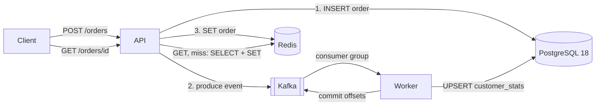
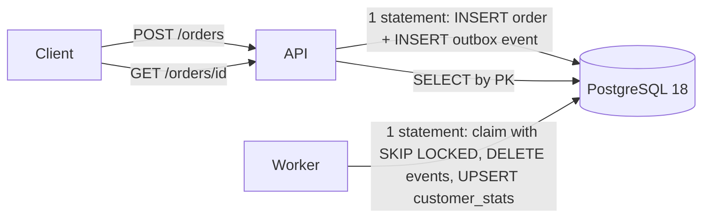

# Event-driven architecture: PostgreSQL + Redis + Kafka vs PostgreSQL 18 only

This demo project compares two implementations of the same event-driven order service:

| Stack | Components | Event transport | Read cache |
|---|---|---|---|
| Classic | PostgreSQL 18.7, Redis 8.10.3, Kafka 4.4.0 (KRaft) | Kafka topic, 12 partitions, consumer group | Redis (write-through + read-through) |
| Modern | PostgreSQL 18.7 | Outbox table, `FOR UPDATE SKIP LOCKED` queue | PostgreSQL shared buffers |

Both stacks use the same PostgreSQL version, the same schema for orders and the same settings.
Only the architecture is different.

- Benchmark results and AWS cost estimate: [RESULT.md](RESULT.md)
- Architecture solutions: [ARCHITECTURE.md](ARCHITECTURE.md)

## Business flow

Both stacks run the same Go service (`app/`) with the same HTTP API and the same projection SQL.

1. `POST /orders` creates an order and emits an `OrderCreated` event.
2. The worker consumes the event and updates the `customer_stats` read model (order count, total amount).
3. `GET /orders/{id}` returns an order.

### Classic stack



- The API does a **dual write**. If the process stops after step 1 and before step 2, the event is lost.
- The worker gives **at-least-once** delivery. It commits Kafka offsets after the projection commit.

### Modern stack



- The order and the event commit in **one statement**. There is no dual-write gap.
- The worker claims, deletes and projects a batch in **one statement**. This gives **exactly-once** processing.
- Idle workers poll every 10 ms. Optional: `PG_NOTIFY=true` enables a `LISTEN/NOTIFY` wake-up.

> **CAUTION:** Do not use `NOTIFY` on a high-rate write path. Each transaction that sends `NOTIFY` takes a
> database-wide lock at commit. All writers then commit one at a time. See `modern-notify` in [RESULT.md](RESULT.md).

## Production-like conditions

| Condition | How the project emulates it |
|---|---|
| Small production instances | Each service has **1 dedicated CPU core** (`cpuset`): PostgreSQL, Redis, Kafka, API, worker. A dedicated core has no CFS throttling, like an EC2 vCPU. |
| Network between services (AWS cross-AZ) | `netproxy` adds **0.5 ms one way = 1 ms round trip** on every hop API/worker → PostgreSQL, Redis, Kafka. |
| Connection pools sized for the network | API PostgreSQL pool = 96 connections. |
| Repeatable numbers | Each scenario runs 3 times. The report shows the median and the range. |

### Why a custom latency proxy

The Docker Desktop VM rounds every timer to approximately 3 ms. Sleep-based tools such as `tc netem` and Toxiproxy
add 3–5 ms instead of 0.5 ms. `netproxy` (`app/netproxy.go`) uses one spin-wait dispatcher thread that writes due
chunks with non-blocking system calls. It is accurate to a few microseconds. The runner measures the real round trip
at each start (`results/<stack>-network.txt`). `netproxy` emulates the network on cores 5–8. Its CPU is not part of
the measured budget. The load generator (k6, cores 9–11) calls the API directly, because the client hop is the same
for all stacks.

## Project structure

| Path | Content |
|---|---|
| `app/` | Go service. `app api` = HTTP API, `app worker` = event consumer, `app netproxy` = latency proxy. `MODE=classic` or `MODE=modern`. |
| `docker/classic/` | Docker Compose environment and schema for the classic stack. |
| `docker/modern/` | Docker Compose environment and schema for the modern stack. |
| `loadtest/orders.js` | k6 load test (scenarios `warmup`, `write_rate`, `write_max`, `mixed`). |
| `scripts/run-benchmark.sh` | Runs all stacks and scenarios with Docker, then generates `RESULT.md`. |
| `scripts/report.py` | Builds `RESULT.md` from `results/`. |
| `scripts/analysis.md` | Hand-written analysis and AWS cost estimate that `report.py` appends to `RESULT.md`. |
| `results/` | Raw results of the last run (k6 summaries, app statistics, `docker stats` samples, network calibration). |

## Prerequisites

- Docker with Docker Compose v2.
- 12 CPUs and 12 GB RAM for Docker. Services use cores 0–4, `netproxy` cores 5–8, k6 cores 9–11.
- Free host ports `8080` and `8081`.

You do not need Go, k6 or Python on the host. All tools run in containers.

## Run the benchmark

1. Open a terminal in the repository root.
2. Run the benchmark:

   ```bash
   scripts/run-benchmark.sh
   ```

3. Wait approximately 45 minutes. The script starts one environment at a time, runs all scenarios, and stops it.
4. Open `RESULT.md`.

Use these environment variables to change the run:

| Variable | Default | Meaning |
|---|---|---|
| `STACKS` | `classic modern-1cpu modern-3cpu modern-notify` | Environments to test, in order. |
| `SCENARIOS` | `write_rate write_max mixed` | k6 scenarios to run on each environment. |
| `DURATION` | `45s` | Duration of each scenario run. |
| `REPEATS` | `3` | Number of runs for each scenario. |
| `RATE` | `5000` | Requests per second in `write_rate`. |
| `VUS` | `192` | Virtual users in `write_max` and `mixed`. |
| `NET_DELAY_US` | `500` | One-way network delay in microseconds. `0` disables the delay. |
| `NETPROXY_CPUSET` | `5-8` | Cores of the latency proxy. |
| `K6_CPUSET` | `9-11` | Cores of the load generator. |
| `API_PG_POOL` | `96` | PostgreSQL connection pool of the API. |

Example: `STACKS="classic modern-1cpu" REPEATS=1 DURATION=30s scripts/run-benchmark.sh`

## Stack variants

| Name | Compose directory | Infrastructure |
|---|---|---|
| `classic` | `docker/classic` | PostgreSQL core 0 / 2 GB, Redis core 1 / 1 GB, Kafka core 2 / 2 GB (3 CPUs) |
| `modern-1cpu` | `docker/modern` | PostgreSQL core 0 / 2 GB |
| `modern-3cpu` | `docker/modern` | PostgreSQL cores 0–2 / 5 GB: same budget as the classic infrastructure |
| `modern-notify` | `docker/modern` | PostgreSQL core 0 / 2 GB with `PG_NOTIFY=true` (`LISTEN/NOTIFY` wake-up) |

All stacks: API core 3 / 512 MB, worker core 4 / 512 MB.

## Start one environment manually

1. Start the environment:

   ```bash
   docker compose -f docker/modern/docker-compose.yml up -d --build --wait
   ```

2. Create an order:

   ```bash
   curl -s -X POST localhost:8080/orders -d '{"customer_id":1,"amount_cents":1999}'
   ```

3. Read the worker statistics:

   ```bash
   curl -s localhost:8081/stats
   ```

4. Stop the environment and delete its data:

   ```bash
   docker compose -f docker/modern/docker-compose.yml down -v
   ```

## Measurement method

- k6 runs in a container on the Docker network of the stack. It calls the API directly.
- The worker measures **event latency**: from the API request start to the commit of the projection.
- The runner waits until the worker processed all events. It records this time as **backlog drain**.
- The runner samples `docker stats` during each run for CPU and memory per container.
- After all runs, the runner compares `count(orders)` with `sum(customer_stats.order_count)`.

## Limitations

- All containers share one Docker host. A Docker CPU here is one Apple silicon core. It is faster than one AWS vCPU.
- Kafka runs as one broker with replication factor 1. PostgreSQL runs without a standby. Production replication adds latency to both stacks.
- Kafka does not `fsync` each message. PostgreSQL does `fsync` the WAL on each commit (`synchronous_commit=on`).
- The read test uses 5,000 hot orders. All of them fit in Redis and in PostgreSQL shared buffers.
